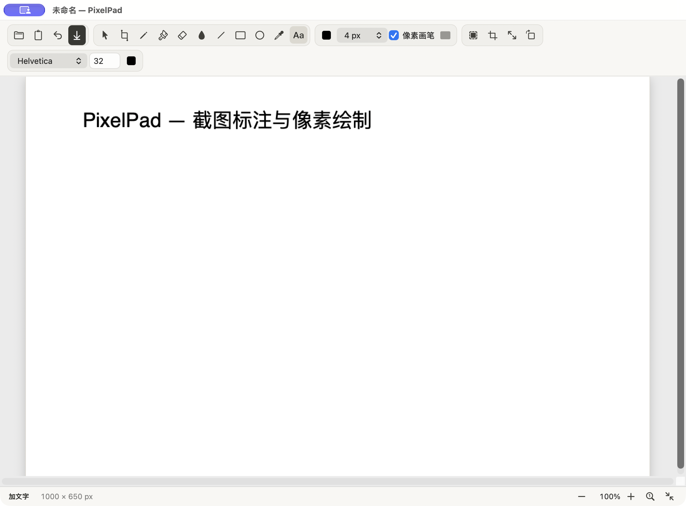
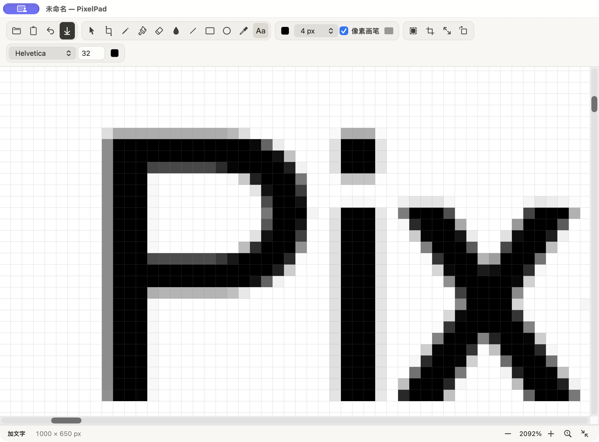

# PixelPad

PixelPad 是一个轻量的 macOS 图片编辑器，适合给截图加字、裁剪图片、调整画布和逐像素绘制。应用使用 Swift 和 AppKit 编写，当前界面为简体中文。

[下载 macOS 版](https://github.com/mindinfor/pixelpad/releases/latest) · [查看 MIT 许可证](LICENSE)

## 界面预览

**工具栏与画布文字**

在画布上直接输入文字，并通过工具栏调整字体、字号和颜色。



**像素网格**

同一段文字放大到 2092%，浅灰网格的每一格对应原图的 1 个像素。



## 功能与特点

| 功能 | 用法 |
| --- | --- |
| 打开和粘贴图片 | 用 ⌘O 打开图片，或用 ⌘V 粘贴剪贴板里的图片。粘贴后可以拖动图片，拖四边中点可调整单轴尺寸，拖四角可等比缩放。 |
| 绘图与取色 | 提供 1 px 铅笔、画笔、橡皮擦、油漆桶、直线、矩形、椭圆和吸色管。颜色面板可以选择色块或输入十六进制颜色。 |
| 两种画笔 | 勾选「像素画笔」使用方形笔头，取消勾选使用边缘平滑的圆形笔头。两种模式均可调整线宽。 |
| 直接在画布上加字 | 按 ⌘T 后点击画布输入，在工具栏选择系统字体、字号和颜色。Return 确认，Esc 取消。用「移动对象」双击已有文字可再次编辑。 |
| 框选与裁剪 | 框选区域后可复制、剪切、填色、移动或缩放选区，也可以裁剪到选区。支持顺时针和逆时针旋转 90°，以及水平和垂直翻转。 |
| 调整画布尺寸 | 在「图像 → 调整画布尺寸」选择像素、百分比或厘米，按需锁定宽高比。可只改画布范围，或让画布和内容等比缩放。 |
| 查看像素 | 支持触控板双指捏合和 ⌘ 加滚轮缩放，普通滚轮滚动画布。缩放，最高 6400%。从 1600% 起显示一像素一格的细网格。状态栏显示图片尺寸、选区位置和选区尺寸。 |
| 导出 PNG | 用 ⌘S 将当前画布另存为 PNG。导出时采用画布的像素尺寸，界面缩放比例和像素网格只用于编辑预览。 |

### 直接拖动调整画布

按 ⌘A 全选画布后，拖四边中点可单独调整宽或高，拖四角可按原比例调整画布。拖动时按住 ⌥，画布内容会一起等比缩放。需要输入精确数值时，使用「调整画布尺寸」。例如，1000 × 650 px 的画布设为 50% 后，尺寸为 500 × 325 px。

## 设计参考

- **Windows 画图（Microsoft Paint）**。PixelPad 参考了它的基础图片编辑流程，例如用铅笔、油漆桶和吸色管绘图，框选后裁剪，在画布上加字并从工具栏调整字体，以及按像素或百分比调整尺寸。 [Microsoft Paint 功能说明](https://www.microsoft.com/en-us/windows/paint)
- **macOS 交互习惯**。PixelPad 用 AppKit 实现菜单栏、打开和保存对话框、系统字体选择与触控板捏合，并使用 ⌘O、⌘S、⌘Z 等 Mac 常用快捷键。 [Apple 的 macOS 设计指南](https://developer.apple.com/design/human-interface-guidelines/designing-for-macos)
- **PixelPad 的交互选择**。画布在工作区居中，工具栏随窗口宽度换行。方形像素笔头可与平滑圆形笔头切换，像素网格在高倍缩放时自动显示。全选画布后可以直接拖动控制点调整尺寸。

## 按厘米制图与打印

1. 按 ⌘N，选择「厘米」，输入宽和高。厘米尺寸按 300 像素/英寸换算，并取整到像素。
2. 按 ⌘P 或点击工具栏的打印机图标，在 macOS 打印面板选择打印机、纸张尺寸和方向。
3. 按实际尺寸打印时，将缩放保持在 100%，并选择可打印区域足够大的纸张。如果旋转能减少裁切，PixelPad 会自动旋转打印内容，并保留设定的缩放比例。6 寸相纸对应 4 × 6 英寸，即 10.16 × 15.24 cm。

## 快捷键

| 操作 | 快捷键 |
| --- | --- |
| 新建画布 / 打印照片 | ⌘N / ⌘P |
| 打开图片 / 另存 PNG | ⌘O / ⌘S |
| 撤销 / 重做 | ⌘Z / ⇧⌘Z |
| 剪切 / 复制 / 粘贴 | ⌘X / ⌘C / ⌘V |
| 全选像素 / 取消框选 | ⌘A / ⌘D |
| 文字工具 | ⌘T |
| 确认文字 / 取消文字编辑 | Return / Esc |
| 放大 / 缩小 | ⌘= / ⌘− |
| 实际大小 / 适合窗口 | ⌘0 / ⌘9 |

## 下载与安装

1. 打开 [Releases](https://github.com/mindinfor/pixelpad/releases/latest)，下载文件名以 `macOS-universal.zip` 结尾的应用压缩包。
2. 解压，将 `PixelPad.app` 拖到「应用程序」文件夹，然后打开。
3. 如需核对文件完整性，在下载目录执行 `shasum -a 256 -c SHA256SUMS.txt`。校验文件在同一发布页。

发布包包含 Apple 芯片和 Intel 两种架构，构建目标为 macOS 13 或更新版本。发布包已在 Apple 芯片 Mac 上验证启动。当前发布包使用临时签名，未经过 Apple 公证。如果 macOS 拦截下载版，可以从源码构建。 [Apple 的 Mac 应用打开说明](https://support.apple.com/zh-cn/102445)

## 从源码构建

需要 Xcode 命令行工具，可用 `xcode-select --install` 安装。

```sh
git clone https://github.com/mindinfor/pixelpad.git
cd pixelpad
./build.sh
open dist/PixelPad.app
```

构建脚本将两种架构打包到同一个应用，无需安装第三方依赖。

## 反馈与许可证

遇到问题可以在 [GitHub Issues](https://github.com/mindinfor/pixelpad/issues) 提交反馈。请附上 PixelPad 版本、macOS 版本和复现步骤。本项目采用 [MIT 许可证](LICENSE)。
